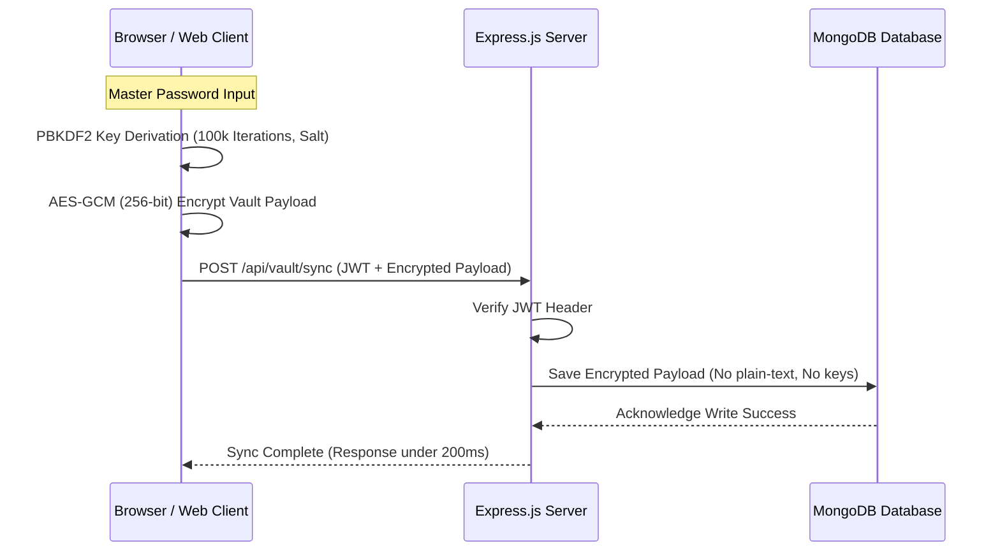

# Project Interview Kit: Alyra Lock
**Secure Zero-Knowledge Password Manager**

---

## 1. System Architecture

---

## 2. Technical Stack
*   **Frontend:** React.js, TypeScript (type safety for cryptographic operations)
*   **Security Library:** Web Crypto API (browser-native, high-performance C++ implementation wrapper)
*   **Backend:** Node.js, Express.js (REST API endpoint handlers)
*   **Database:** MongoDB (document storage for serialized encrypted JSON vaults)

---

## 3. Core Implementation Details
*   **Key Derivation:** Utilizes PBKDF2 (Password-Based Key Derivation Function 2) with SHA-256 hash, 100,000 iterations, and a randomly generated cryptographically secure salt. This protects against brute-force and rainbow table attacks.
*   **Encryption Protocol:** Uses AES-GCM (Advanced Encryption Standard - Galois/Counter Mode) with 256-bit keys and a unique 12-byte initialization vector (IV) per encryption operation. Galois/Counter Mode provides both confidentiality and data integrity (authenticated encryption).
*   **Zero-Knowledge Integrity:** The master password and the derived key are kept entirely in client memory. The server only receives the encrypted payload and salt, making server-side data extraction impossible in the event of a database breach.

---

## 4. Key Architectural Trade-offs

### Client-Side vs. Server-Side Key Derivation
*   *Server-Side:* Easier to implement, but requires sending the password (or a hash) over the wire. If the server is compromised, user credentials can be captured in memory.
*   *Client-Side (Selected):* Cryptographic work is offloaded to the user's browser, preventing the server from ever seeing the plaintext password or derived keys. The trade-off is higher CPU usage on the client during login, which we optimized by utilizing the browser-native Web Crypto API.

### AES-GCM vs. AES-CBC
*   *AES-CBC:* Requires manual padding and an external HMAC to verify integrity. It is vulnerable to padding oracle attacks if not implemented perfectly.
*   *AES-GCM (Selected):* Provides built-in authentication tag validation, rendering tampering attempts immediately detectable during decryption.

---

## 5. Security & Verification Analysis
*   **Cross-Site Scripting (XSS) Mitigation:** We implemented strict Content Security Policies (CSP) to block external scripts and verify all network calls.
*   **CORS (Cross-Origin Resource Sharing) Policies:** Express backend endpoints are configured with strict origin allowlists, rejecting requests from non-approved domains.
