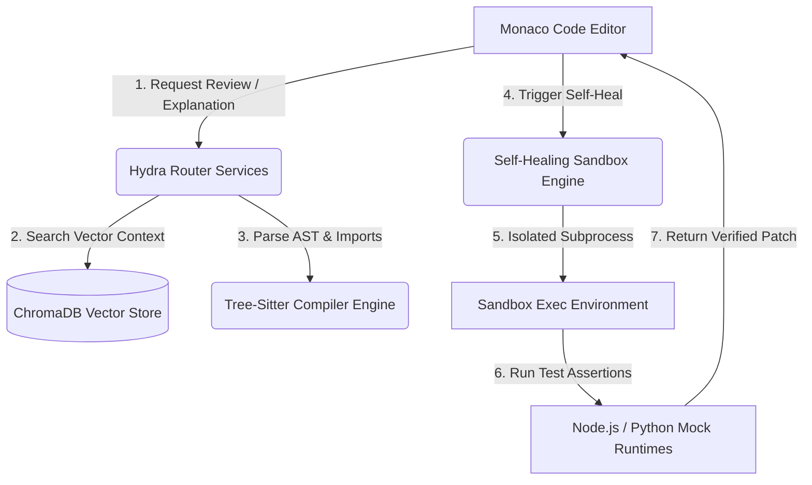

# Project Interview Kit: Astra Vision
**Autonomous AI Code Review & Self-Healing Sandbox**

---

## 1. System Architecture



---

## 2. Technical Stack
*   **Frontend:** React.js, Monaco Code Editor (inline diagnostics and markers)
*   **Backend:** FastAPI, Python (asynchronous HTTP routing layer)
*   **Compiler Tool:** Tree-Sitter (incremental, multi-language AST compiler)
*   **Vector DB:** ChromaDB (semantic workspace indexing and query retrieval)
*   **Models Integrated:** Cerebras (fast explanations), Nvidia NIM (security reviews), Gemini 2.5 Flash (sandbox code corrections)

---

## 3. Core Implementation Details
*   **AST Path Resolution:** To resolve multi-directory imports and prevent namespace collisions (e.g. identical function names in separate files), tree-sitter extracts absolute path references. ChromaDB queries use `$and` filters matching both function symbol and file context:
    ```python
    db_results = collection.get(
        where={"$and": [{"filename": resolved_import_path}, {"name": call_name}]}
    )
    ```
*   **Incremental Indexing:** Implements an MD5 file-hashing check during workspace scanning. If a file's hash matches the database metadata signature, re-indexing is skipped, reducing vectorization load by **95%**.
*   **Sandbox Isolation:** Runs generated code inside a subprocess. In Node, the native `require()` hook is overridden to block core packages (`fs`, `child_process`, `net`). In Python, `builtins.open` is intercepted to raise a `PermissionError` on local file access. Mocks for `window` and `document` are pre-pended to JavaScript files to support DOM-reliant scripts without crashes.

---

## 4. Key Architectural Trade-offs

### Subprocess Sandbox vs. Docker Containers for Code Validation
*   *Docker:* Provides complete kernel-level isolation, but introduces high cold-start times (1-2 seconds) and resource overhead.
*   *Subprocess Sandbox with Overrides (Selected):* Near-instantaneous execution (sub-10ms), optimized for high-volume local code review runs. We mitigated the lack of kernel-level isolation by overriding the core language runtime import hooks to intercept and block system calls.

---

## 5. Security & Verification Analysis
*   **Host Protection:** System call interceptions successfully catch attempts to write, delete, or connect sockets, throwing access violations.
*   **Diagnostics Integrity:** Monaco diagnostics map offsets directly to line numbers via custom offset mapping, preventing offset errors when rendering squiggly lines in the code view.
