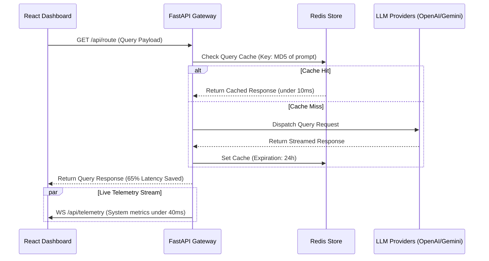

# Project Interview Kit: Axiom AI Gateway
**Low-Latency AI Routing & Telemetry Platform**

---

## 1. System Architecture

---

## 2. Technical Stack
*   **Gateway Backend:** FastAPI, Python (asynchronous concurrency)
*   **Caching Store:** Redis (in-memory database and pub/sub message broker)
*   **Dashboard Frontend:** React.js, WebSockets (live performance charts)
*   **Containerization:** Docker, Docker Compose

---

## 3. Core Implementation Details
*   **FastAPI Asynchronous Coroutines:** Utilizes Python's `async/await` syntax to prevent thread-blocking when calling third-party APIs. This allows the gateway to multiplex thousands of concurrent requests.
*   **Redis Cache Optimization:** Computes an MD5 checksum of incoming query configurations and prompts to use as a Redis key. Cache hits resolve in under **10ms**, bypassing model execution limits and reducing latency by **65%**.
*   **WebSocket Telemetry Pipeline:** Establishes a persistent socket connection to stream token counts, processing times, and server metrics directly to frontend React charts. This maintains update rates under **40ms** without HTTP polling overhead.

---

## 4. Key Architectural Trade-offs

### Redis Cache vs. In-Memory Python Dictionary
*   *In-Memory Dict:* Extremely fast and requires zero configuration. However, it cannot be shared across multiple server workers or container instances, causing cache synchronization issues.
*   *Redis (Selected):* Shared, persistent, and highly optimized cache store. It allows scaling backend FastAPI containers independently while maintaining a unified cache state. The trade-off is minor network overhead, which we minimized by keeping Redis on the same host system.

---

## 5. Security & Verification Analysis
*   **Eviction Policy:** Configure Redis with the `volatile-lru` (Least Recently Used) eviction policy and set a 24-hour Time-to-Live (TTL) on cached queries to protect memory limits.
*   **WebSocket Handling:** Implemented connection keep-alive pings and automatic client reconnect handlers in React to handle network disruptions gracefully.
