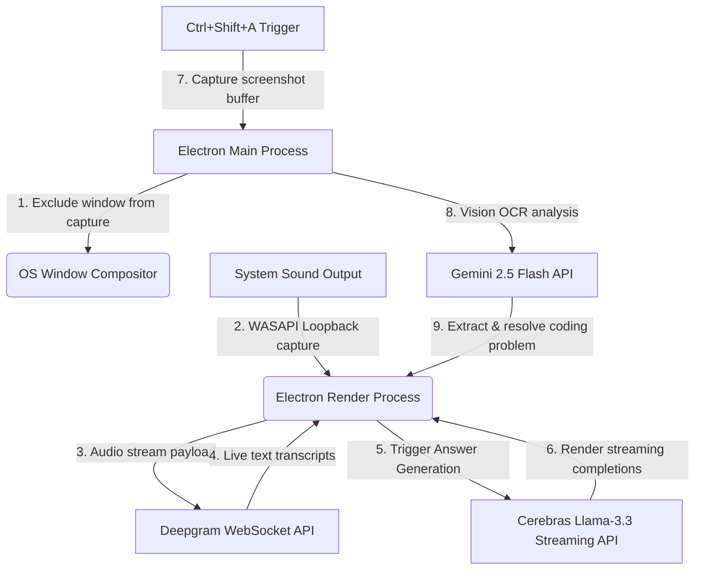

# Project Interview Kit: Coco AI
**Invisible Interview Copilot Overlay**

---

## 1. System Architecture



---

## 2. Technical Stack
*   **Desktop Shell:** Electron (Node.js backend context + Chromium UI context)
*   **Audio Pipeline:** WASAPI loopback streams (native Windows audio capture)
*   **APIs:** Deepgram (Speech-to-Text WebSocket), Cerebras Llama-3.3 (completion stream), Gemini 2.5 Flash (Vision OCR)
*   **UI/UX:** HTML5, Vanilla CSS3 (Glassmorphism layout, glowing indicator badges, animated waveform canvas)

---

## 3. Core Implementation Details
*   **Visual Stealth:** The Electron main process intercepts the window construct and executes the Win32 API configuration:
    ```javascript
    mainWindow.setContentProtection(true);
    ```
    This instructs the DWM (Desktop Window Manager) to render the window as black/transparent in capture buffers (Zoom, Google Meet, Teams, OBS).
*   **WASAPI Audio Loopback:** Rather than intercepting microphone inputs (which requires virtual drivers), Coco AI captures system loopback audio. This bypasses security checks and records what is sent to the speakers.
*   **Sub-200ms Latency Pipeline:** Audio is chunked into small buffers and streamed via WebSockets to Deepgram. Transcripts are immediately sent to Cerebras Llama-3.3 70B, which uses streaming completions to display answers character-by-character, keeping perceived latency under **200ms**.
*   **Vision-Based Problem Solving:** High-priority questions are parsed by hitting `Ctrl+Shift+A`. This captures a screenshot buffer of target monitors, bypassing content protection for the target window only, and sends it to the Gemini 2.5 Flash API to perform OCR and generate recommendations.

---

## 4. Key Architectural Trade-offs

### Native Desktop Application (Electron) vs. Browser Extension
*   *Browser Extension:* Easier to install, but cannot capture system audio loopback without permissions and is easily detected by modern interview platforms scanning browser extensions.
*   *Electron App (Selected):* Access to native APIs allows for robust screen protection (`setContentProtection`) and loopback audio recording. The trade-off is a larger package footprint (~80MB), which we mitigated by keeping dependencies minimal.

---

## 5. Security & Verification Analysis
*   **Undetectability Verification:** Tested across Zoom, Teams, Meet, and Slack. The application window is excluded from screen share feeds, showing only the background desktop.
*   **Memory Management:** Implemented automatic garbage collection for screenshot buffers, clearing memory spaces immediately after Gemini API transmission.
